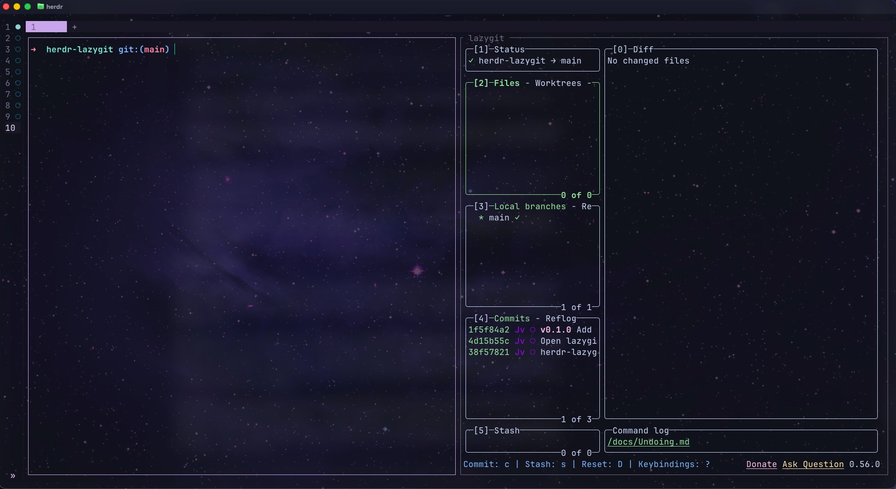
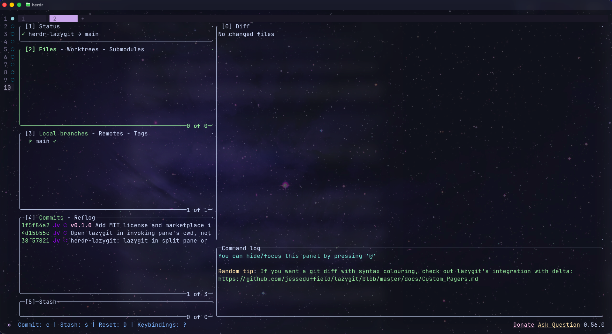

# herdr-lazygit

Open [lazygit](https://github.com/jesseduffield/lazygit) in a herdr split pane or its own tab, with smart toggle: press once to open, again to focus, and again (while focused) to close. Quitting lazygit (`q`) closes the pane.

**Split pane** (`prefix+l`) — lazygit beside your work:



**Own tab** (`prefix+shift+l`) — full-window lazygit:



Requires herdr ≥ 0.7.0, `lazygit`, and `jq` (without jq the shortcut still opens lazygit, it just loses the toggle).

## Install

```bash
herdr plugin install JacquesvanWyk/herdr-lazygit
herdr plugin list   # confirm herdr-lazygit is registered
```

For local development:

```bash
herdr plugin link /path/to/herdr-lazygit
```

## Keybindings

Add to `~/.config/herdr/config.toml`:

```toml
[[keys.command]]
key = "prefix+l"
type = "shell"
command = "herdr plugin action invoke open-lazygit --plugin herdr-lazygit"

[[keys.command]]
key = "prefix+shift+l"
type = "shell"
command = "herdr plugin action invoke open-lazygit-tab --plugin herdr-lazygit"
```

Then reload:

```bash
herdr server reload-config
```

Or invoke without a keybinding:

```bash
herdr plugin action invoke open-lazygit --plugin herdr-lazygit
herdr plugin action invoke open-lazygit-tab --plugin herdr-lazygit
```
